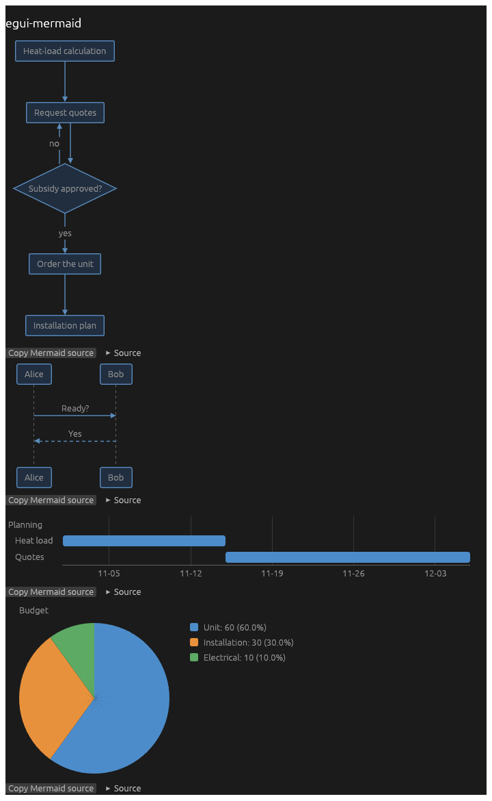

# egui-mermaid

[Mermaid](https://mermaid.js.org) diagrams in [egui](https://github.com/emilk/egui) in Rust with wasm32 support.



Drawn: flowcharts (`graph`, `flowchart`; shapes, subgraphs, edge labels, dotted and thick
lines), state, class and entity-relationship diagrams and mind maps (drawn as flowcharts),
sequence diagrams (notes, `loop`/`alt` frames), Gantt charts (`dateFormat`, `axisFormat`,
`after`, durations), user journeys, git graphs and pie charts. Other kinds are reported as
unsupported. Flowcharts use a layered (Sugiyama) layout.

## Use

```toml
[dependencies]
egui-mermaid = "0.1"
```

Markdown with ```` ```mermaid ```` blocks, through
[egui_commonmark](https://crates.io/crates/egui_commonmark) (feature `markdown`, default):

```rust
let mut cache = egui_commonmark::CommonMarkCache::default();
// each frame:
egui_mermaid::markdown(ui, &mut cache, text);
```

One diagram:

```rust
if let Err(kind) = egui_mermaid::diagram(ui, "graph TD\n  A --> B") {
    ui.label(format!("{kind} diagrams are not drawn"));
}
```

A diagram is drawn at its natural size, scaled down to the available width (to 60 %, then it
scrolls horizontally), in colours from `ui.visuals()`. `egui_mermaid::layout` gives the parsed
and laid-out geometry without egui, and `split` cuts text into Markdown and Mermaid parts (an
unclosed block, e.g. while an answer streams, stays Markdown).

`cargo run --example demo` opens a window with the diagrams above.

## Versions

| egui-mermaid | egui | egui_commonmark |
|--------------|------|-----------------|
| 0.1          | 0.36 | 0.25            |

## License

MIT
